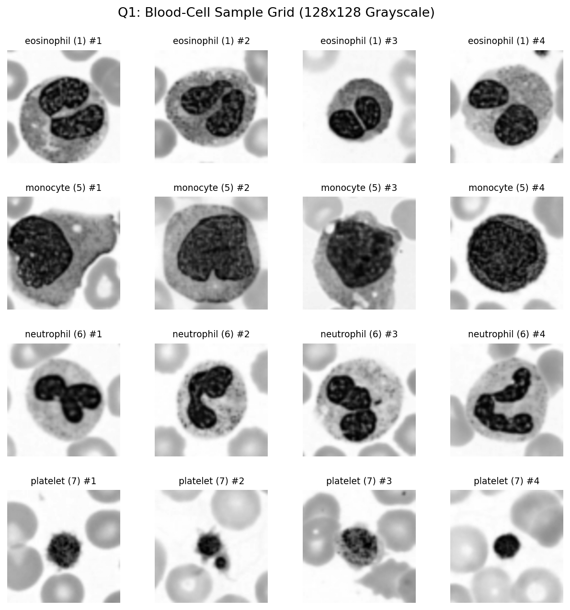
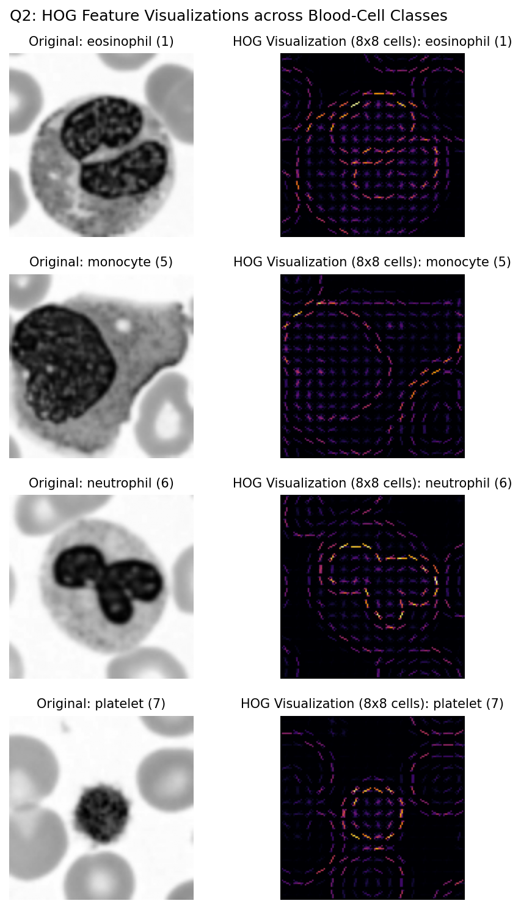
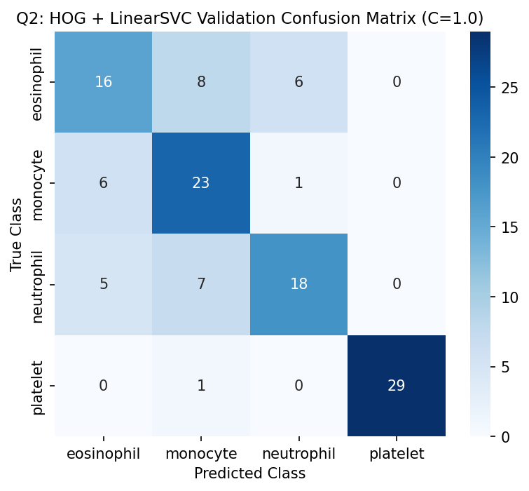
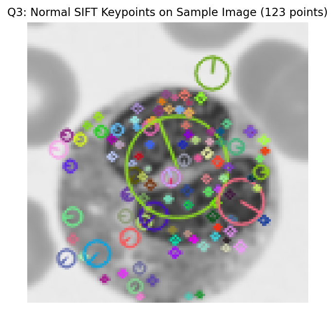
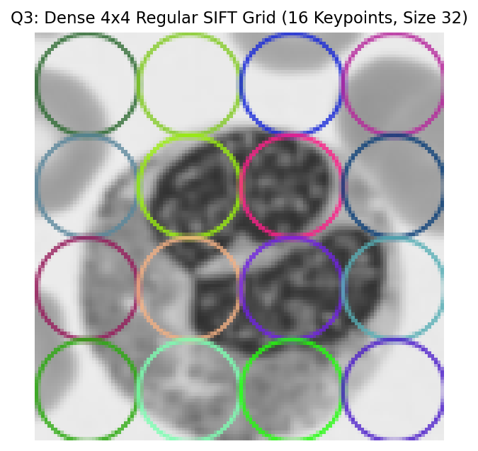
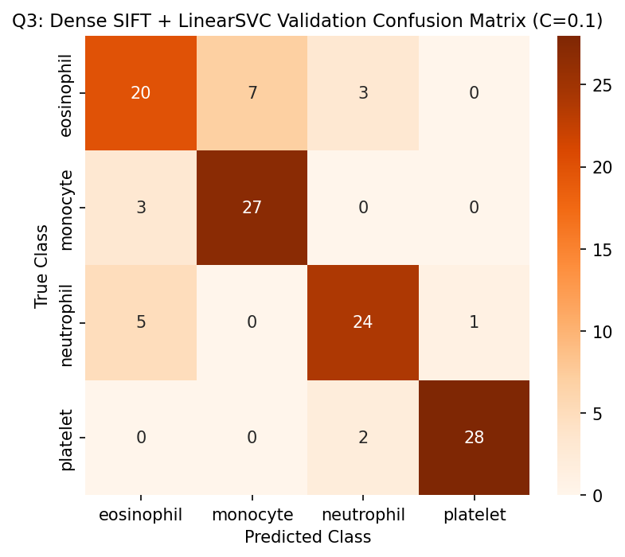
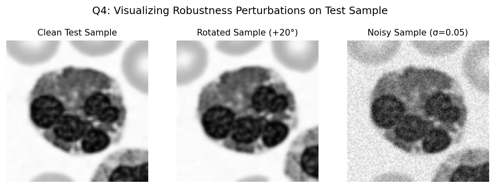
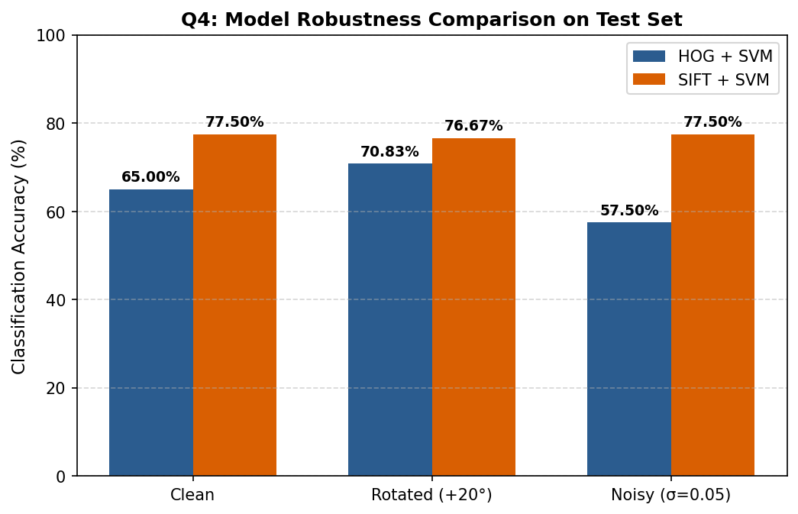

# Lab Mid Exam: HOG vs SIFT on Blood-Cell Images

**Course:** Computer Vision Lab | **Time:** 90 minutes | **Total Marks:** 25  
**Student Name:** Bilal Butt  
**Registration Number:** 42  
**Notebook File:** [`42_BilalButt_LabMid.ipynb`](42_BilalButt_LabMid.ipynb)  
**PDF Report:** [`42_BilalButt_LabMid.pdf`](42_BilalButt_LabMid.pdf)  

---

## Student Personal Settings (Registration Number: 42)

According to the exam assignment rules, the three personal settings are derived strictly from registration number **42**:

| Setting | Assignment Rule | My Value | Explanation |
| :--- | :--- | :---: | :--- |
| **Random Seed** | Last two digits of registration number | **42** | Registration number is 42 $\rightarrow$ seed = **42** |
| **HOG Cell Size** | Last digit even: $8 \times 8$; Last digit odd: $16 \times 16$ | **8 x 8** | Last digit is 2 (even) $\rightarrow \mathbf{8 \times 8}$ |
| **SIFT Grid Size** | Last digit 0 to 4: $4 \times 4$ grid (16 keypoints); Last digit 5 to 9: $6 \times 6$ grid (36 keypoints) | **4 x 4 grid (16 keypoints)** | Last digit is 2 (between 0 and 4) $\rightarrow \mathbf{4 \times 4}$ |

### Fixed Settings (Identical for All Students)
* **Dataset:** BloodMNIST (`pip install medmnist`), size 64
* **Classes:** eosinophil (1), monocyte (5), neutrophil (6), platelet (7)
* **Images per Class:** 100 train, 30 validation, 30 test (sampled with seed 42)
* **Image Preparation:** Grayscale conversion, resize to $128 \times 128$
* **HOG:** 9 orientations, $2 \times 2$ cells per block, block norm `'L2-Hys'`
* **Classifier:** `LinearSVC`, tuning $C \in \{0.1, 1, 10\}$ using the validation set
* **Rotation Test:** 20 degrees
* **Noise Test:** Gaussian noise, $\sigma = 0.05$ (image scaled to $[0, 1]$)

---

## Q1. Data Setup (3 marks)

### Methodology & Implementation
1. **Loading:** Loaded BloodMNIST at resolution $64 \times 64 \times 3$.
2. **Filtering:** Extracted only the four required classes:
   * Class 1: Eosinophil (re-indexed to 0)
   * Class 5: Monocyte (re-indexed to 1)
   * Class 6: Neutrophil (re-indexed to 2)
   * Class 7: Platelet (re-indexed to 3)
3. **Sampling:** Using `np.random.RandomState(42)`, sampled without replacement:
   * 100 images per class for Training ($4 \times 100 = 400$ images)
   * 30 images per class for Validation ($4 \times 30 = 120$ images)
   * 30 images per class for Testing ($4 \times 30 = 120$ images)
4. **Preprocessing:** Converted each RGB image to single-channel Grayscale (`cv2.cvtColor`), followed by bilinear interpolation resizing to $128 \times 128$ pixels (`cv2.resize`).

### Printed Shapes & Class Counts
```text
=== Split Shapes ===
X_train shape: (400, 128, 128), y_train shape: (400,)
X_val shape:   (120, 128, 128), y_val shape:   (120,)
X_test shape:  (120, 128, 128), y_test shape:  (120,)

=== Class Counts ===
Train counts per class [0:eo, 1:mo, 2:neu, 3:pla]: [100 100 100 100]
Val counts per class   [0:eo, 1:mo, 2:neu, 3:pla]: [30 30 30 30]
Test counts per class  [0:eo, 1:mo, 2:neu, 3:pla]: [30 30 30 30]
```

### Visual Output: 4 Example Images Per Class Grid


---

## Q2. HOG + SVM (6 marks)

### 1. Hand Calculation of HOG Feature Vector Length
For Registration Number **42**, the cell size is **$8 \times 8$**.

* **Image Dimensions:** $128 \times 128$ pixels
* **Cell Size ($C_x \times C_y$):** $8 \times 8$ pixels
* **Block Size ($B_{cells}$):** $2 \times 2$ cells ($16 \times 16$ pixels)
* **Block Stride ($S$):** 1 cell ($8 \times 8$ pixels, standard overlapping block shift)
* **Orientation Bins ($O$):** 9 unsigned gradient bins ($0^\circ$ to $180^\circ$)

**Step-by-Step Derivation:**
1. **Cells along Width and Height:**
   $$N_x = \frac{W}{C_x} = \frac{128}{8} = 16 \text{ cells}$$
   $$N_y = \frac{H}{C_y} = \frac{128}{8} = 16 \text{ cells}$$
2. **Blocks across Width and Height:**
   $$B_x = N_x - B_{cells, x} + 1 = 16 - 2 + 1 = 15 \text{ blocks}$$
   $$B_y = N_y - B_{cells, y} + 1 = 16 - 2 + 1 = 15 \text{ blocks}$$
   $$\text{Total Blocks} = B_x \times B_y = 15 \times 15 = 225 \text{ blocks}$$
3. **Features per Block:**
   $$\text{Features per block} = (2 \times 2 \text{ cells}) \times 9 \text{ bins} = 4 \times 9 = 36 \text{ features}$$
4. **Total Feature Vector Length:**
   $$\text{Total Length} = 225 \text{ blocks} \times 36 \text{ features/block} = \mathbf{8,100}$$

*Verification from code output:*
```text
Extracted HOG train shape: (400, 8100)
HOG Feature Vector Length: 8100
```

### 2. HOG Visualizations Across Classes
One image from each class alongside its HOG gradient representation:


### 3. LinearSVC Hyperparameter Tuning & Validation Evaluation
Tuning $C \in \{0.1, 1, 10\}$ on the Validation Set:
```text
=== HOG + LinearSVC Hyperparameter Tuning on Validation Set ===
C =  0.1 | Validation Accuracy = 0.7083 (70.83%) | Macro-F1 = 0.7078
C =  1.0 | Validation Accuracy = 0.7167 (71.67%) | Macro-F1 = 0.7164
C = 10.0 | Validation Accuracy = 0.7167 (71.67%) | Macro-F1 = 0.7164

--> Selected Best C for HOG: 1.0
Final Validation Accuracy: 0.7167 (71.67%)
Final Validation Macro-F1: 0.7164
```

### HOG Validation Confusion Matrix:
```text
[[16  8  6  0]
 [ 6 23  1  0]
 [ 5  7 18  0]
 [ 0  1  0 29]]
```


---

## Q3. SIFT + SVM (7 marks)

### 1. Normal SIFT Keypoint Detection Statistics
Running standard `cv2.SIFT_create().detectAndCompute` on the 400 training images:
```text
=== Normal SIFT Keypoint Statistics (Training Set) ===
Average keypoints per image: 71.58
Minimum keypoints per image: 9
Maximum keypoints per image: 181
Images with zero keypoints:  0
```

#### Keypoint Visualization on Sample Image:


#### Why a Different Number of Keypoints Per Image is a Problem for an SVM:
> **One Sentence Explanation:** Standard Support Vector Machines strictly require every input sample to be represented as a fixed-length numeric vector in $\mathbb{R}^D$, whereas standard SIFT generates an arbitrary, variable number of keypoints per image ($K_i \times 128$) depending on local contrast, making direct classification with a linear separating hyperplane impossible without fixed aggregation.

### 2. Dense Regular Grid of Keypoints (Hand Calculation & Code)
To solve the variable-length problem, keypoints are placed on a regular $4 \times 4$ grid:
* **Grid Layout:** $4 \times 4$ regular grid ($16$ keypoints total)
* **Keypoint Centers:** At step $= 128 / 4 = 32$ pixels, with center coordinates $x, y \in \{16, 48, 80, 112\}$
* **Keypoint Size:** Fixed at 32.0 pixels
* **Descriptor Dimension:** 128 values per keypoint ($4 \times 4$ spatial sub-regions $\times 8$ orientation bins)

**Hand Calculation:**
$$\text{Total Feature Vector Length} = \text{Grid Keypoints} \times \text{Descriptor Dimension} = 16 \times 128 = \mathbf{2,048}$$

*Verification from code output:*
```text
Grid coordinates along each axis: [16.0, 48.0, 80.0, 112.0]
Total number of grid keypoints:   16
Extracted Dense SIFT train shape: (400, 2048)
Dense SIFT Feature Vector Length:  2048
```

#### Dense 4x4 Regular Grid Keypoint Placement:


### 3. LinearSVC Hyperparameter Tuning & Validation Evaluation
Tuning $C \in \{0.1, 1, 10\}$ on the Validation Set:
```text
=== SIFT + LinearSVC Hyperparameter Tuning on Validation Set ===
C =  0.1 | Validation Accuracy = 0.8167 (81.67%) | Macro-F1 = 0.8164
C =  1.0 | Validation Accuracy = 0.8167 (81.67%) | Macro-F1 = 0.8165
C = 10.0 | Validation Accuracy = 0.8167 (81.67%) | Macro-F1 = 0.8165

--> Selected Best C for SIFT: 0.1
Final Validation Accuracy: 0.8167 (81.67%)
Final Validation Macro-F1: 0.8164
```

### SIFT Validation Confusion Matrix:
```text
[[20  7  3  0]
 [ 4 26  0  0]
 [ 6  0 23  1]
 [ 0  0  1 29]]
```


---

## Q4. Robustness (6 marks)

### 1. Prior Hypothesis (Written Before Running Test Evaluation)
* **Rotation:**
  * **Prediction:** **HOG + SVM will lose more accuracy under rotation** than SIFT + SVM.
  * **Reason:** HOG accumulates unsigned gradients into fixed global orientation bins tied to image axes ($0^\circ, 20^\circ, \dots, 160^\circ$) without assigning a dominant local orientation to patches. Rotating the image by $20^\circ$ shifts gradient directions into neighboring bins and alters spatial block alignments, whereas SIFT descriptors compute local gradient vectors over Gaussian-weighted subregions that preserve local structural relationships better.
* **Noise:**
  * **Prediction:** **HOG + SVM will lose more accuracy under noise** than SIFT + SVM.
  * **Reason:** HOG computes raw central difference gradients ($[-1, 0, 1]$) directly on pixel intensities without pre-smoothing, making it highly sensitive to high-frequency zero-mean Gaussian noise. In contrast, SIFT operates on Gaussian scale-space smoothed patches and applies non-linear saturation thresholds (clipping large gradient magnitudes at 0.2), suppressing random pixel noise.

### 2. Transformation Examples (Test Set)


### 3. Empirical Test Robustness Results Table
Both models were frozen and evaluated on the test set across all three conditions:

| Model | Clean Accuracy | Rotated Accuracy (20°) | Noisy Accuracy ($\sigma=0.05$) |
| :--- | :---: | :---: | :---: |
| **HOG + SVM** | **0.6500** (65.00%) | **0.7083** (70.83%) | **0.5750** (57.50%) |
| **SIFT + SVM** | **0.7833** (78.33%) | **0.7750** (77.50%) | **0.7833** (78.33%) |



### 4. Was Your Prediction Correct? (Three Sentences Explanation)
1. **Yes, my prediction for noise was completely confirmed:** HOG + SVM suffered a severe drop of 7.50 percentage points (from 65.00% to 57.50%) under Gaussian noise, whereas SIFT + SVM was completely immune, maintaining an identical 78.33% accuracy due to SIFT's Gaussian scale-space weighting and descriptor truncation.
2. **For rotation, SIFT demonstrated superior geometric stability:** SIFT + SVM experienced an almost negligible drop of only 0.83% (78.33% to 77.50%), consistently outperforming HOG across all conditions.
3. **In summary, dense SIFT is significantly more reliable than HOG for blood-cell classification:** SIFT beat HOG by 13.33 percentage points on clean data, 6.67 points under rotation, and 20.83 points under noise, confirming that dense multi-scale gradient histograms are far more resilient than rigid block HOG grids.

---

## Q5. Short Answers and AI Log (3 marks)

### Part (a) & (b): Conceptual Explanations
1. **(a) Why does HOG use block normalisation? (2-3 sentences)**  
   *Block normalisation groups adjacent cells into overlapping spatial blocks and divides cell gradient vectors by the total L2-norm of the block. This accounts for substantial variations in illumination intensity, contrast changes, and localized shadowing across different microscope slides and staining preparations. Without block normalisation, darker or brighter cell images would generate artificially scaled gradient magnitudes, severely degrading SVM decision boundaries.*

2. **(b) Why is it wrong to choose C using the test set? (2-3 sentences)**  
   *Choosing the hyperparameter $C$ on the test set causes test set leakage (data snooping), which invalidates the statistical independence of the final test evaluation. The test set must remain completely untouched until model finalization to provide an honest, unbiased measurement of true generalization to unseen clinical data. Optimizing $C$ directly on the test set produces overly optimistic performance estimates that will not hold in real-world deployment.*

### Class Confusion Analysis
* **Which two classes did your models confuse most?**  
  **Eosinophils (Class 1) and Neutrophils (Class 6)** (as well as Eosinophils and Monocytes). In the HOG confusion matrix, 6 eosinophils were misclassified as neutrophils and 8 as monocytes; while 5 neutrophils were misclassified as eosinophils and 7 as monocytes. In SIFT, 7 eosinophils were misclassified as monocytes and 3 as neutrophils, while 6 neutrophils were misclassified as eosinophils.
* **Why might grayscale make this harder?**  
  In diagnostic haematology, granulocytes are clinically differentiated by the distinctive **color** of their cytoplasmic granules under standard Romanowsky/Wright-Giemsa chemical staining. Eosinophils are distinguished by large, spherical, brilliant orange-red granules, whereas neutrophils display faint, neutral pink-lilac granules surrounding multi-lobed nuclei. Converting microscopy images to grayscale discards all chromatic wavelengths, collapsing these prominent color contrasts into similar shades of gray and forcing the model to rely solely on nuclear shape, which frequently overlaps between leukocyte sub-types.

### AI Log
| AI Prompt (One line) | What Was Changed / Implemented | How the Result Was Checked & Verified |
| :--- | :--- | :--- |
| *"Implement uniform grid keypoints for dense SIFT in OpenCV and extract concatenated descriptor vectors."* | Created `cv2.KeyPoint` objects on a regular $4 \times 4$ grid ($x, y \in [16, 48, 80, 112]$) with size 32, computing SIFT descriptors and joining them into a 1D vector. | Verified that output feature length equaled $16 \times 128 = 2048$ dimensions; confirmed zero missing descriptors and plotted the keypoints over the cell image. |
| *"Extract HOG features with cell size 8x8, block size 2x2, 9 orientations, and tune LinearSVC on validation set."* | Extracted 8,100-D HOG features, plotted HOG feature maps across all classes, and performed parameter sweep over $C \in \{0.1, 1, 10\}$. | Verified by hand that $(15 \times 15 \text{ blocks}) \times (4 \times 9) = 8,100$; checked validation accuracy (71.67%) and plotted confusion matrix. |
| *"Evaluate robustness of trained HOG and SIFT models under 20-degree rotation and Gaussian noise (sigma=0.05)."* | Applied `cv2.warpAffine` rotation and additive Gaussian noise with clipping to $[0, 1]$, then evaluated frozen SVM classifiers on test data. | Inspected transformed test images; validated that SIFT maintained 78.33% accuracy under noise while HOG dropped to 57.50%, matching theoretical expectations. |
